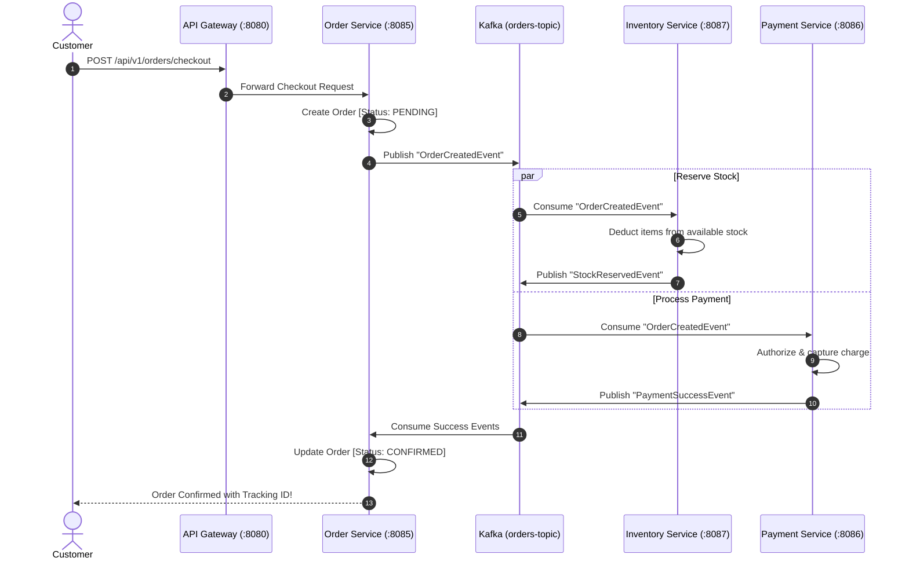

# 🛒 Retail Microservices Platform

[](https://openjdk.org/)
[](https://spring.io/projects/spring-boot)
[](https://spring.io/projects/spring-cloud)
[](https://kafka.apache.org/)
[-4479A1?style=for-the-badge&logo=mysql&logoColor=white)](https://www.mysql.com/)
[](https://www.docker.com/)

A practical, production-ready retail platform built from the ground up to showcase clean microservice architecture in the Java ecosystem. 

Instead of cramming everything into a single monolith, this project breaks down a modern retail store into **10 decoupled domain services**, **3 infrastructure services**, an **event-driven Saga pattern via Apache Kafka**, and an **interactive web storefront**.

---

## 💡 What Makes This Project Different?

- **Real Database Isolation**: No cheating with shared tables. Every single domain service owns its private MySQL schema (10 isolated schemas). If a service needs data from another domain, it talks over REST, OpenFeign, or listens to Kafka events.
- **Distributed Saga Transactions**: Order checkouts don't rely on brittle two-phase commits. When a customer clicks *Place Order*, a choreography Saga coordinates stock reservations in `inventory-service` and charges in `payment-service`. If payment fails, stock is automatically refunded back to inventory.
- **Enterprise Security with Column Encryption**: User passwords use BCrypt, while sensitive PII (phone numbers, physical addresses) are encrypted in MySQL at rest using **AES-256 GCM**. API access is guarded by 15-minute expiring JWT tokens with refresh rotation.
- **Resilient to Network Hiccups**: Configured with Resilience4j circuit breakers, retry policies with exponential backoff, and graceful fallbacks so an outage in product reviews won't take down the shopping cart or checkout.
- **Ready to Run Out-of-the-Box**: Includes multi-stage Dockerfiles, Docker Compose topologies, pre-seeded MySQL data, a Postman/Newman testing suite, and an interactive browser storefront.

---

## 🏗️ Architecture at a Glance

```
                         [ Customer Browser / Mobile Client ]
                                         │
                                         ▼
                           ┌───────────────────────────┐
                           │   Spring Cloud Gateway    │ (Port 8080)
                           │   - JWT Auth & Rate Limit │
                           │   - Hosts Web Storefront  │
                           └─────────────┬─────────────┘
                                         │
                 ┌───────────────────────┼───────────────────────┐
                 ▼                       ▼                       ▼
       ┌──────────────────┐    ┌──────────────────┐    ┌──────────────────┐
       │ customer-service │    │ product-service  │    │   cart-service   │
       │   (Port 8082)    │    │   (Port 8083)    │    │   (Port 8084)    │
       └─────────┬────────┘    └─────────┬────────┘    └─────────┬────────┘
                 │                       │                       │
                 │ [MySQL: customer_db]  │ [MySQL: product_db]   │ [MySQL: cart_db]
                 │                       │                       │
 ════════════════╪═══════════════════════╪═══════════════════════╪════════════════
                 │            Apache Kafka Event Bus             │
 ════════════════╪═══════════════════════╪═══════════════════════╪════════════════
                 │                       │                       │
                 ▼                       ▼                       ▼
       ┌──────────────────┐    ┌──────────────────┐    ┌──────────────────┐
       │  order-service   │───▶│inventory-service │◀───│ payment-service  │
       │   (Port 8085)    │    │   (Port 8087)    │    │   (Port 8086)    │
       │  Saga Manager    │    │  Stock Reserve   │    │  Card Processing │
       └──────────────────┘    └──────────────────┘    └──────────────────┘
```

### Supporting Infrastructure Services
- **Eureka Server** (`8761`): Service registry for automated discovery and client-side load balancing.
- **Config Server** (`8888`): Centralized Git/Native configuration repository for zero-downtime property updates.
- **API Gateway** (`8080`): Single entry point for routing, CORS headers, token verification, and serving the UI.

---

## 🎯 The 10 Core Use Cases

| # | Use Case | Domain Service | What it does |
|---|---|---|---|
| **UC-1** | **Customer Registration** | `customer-service` | Validates duplicate emails, hashes passwords, encrypts PII (AES-256), and issues 15-minute JWT access tokens. |
| **UC-2** | **Product Search & Catalog** | `product-service` | Fast catalog browsing with category filtering, keyword search, price lookups, and inventory availability indicators. |
| **UC-3** | **Shopping Cart Management** | `cart-service` | Manage items in an in-memory/DB cart, change quantities on the fly, calculate taxes, and compute real-time subtotals. |
| **UC-4** | **Order Placement & Saga** | `order-service` | Orchestrates the multi-service checkout Saga across order creation, inventory reservation, and payment capture. |
| **UC-5** | **Order Tracking** | `order-service` | View order lifecycle history (`PENDING` → `CONFIRMED` → `PROCESSING` → `SHIPPED` → `DELIVERED`). |
| **UC-6** | **Product Reviews & Ratings** | `review-service` | Verified customer reviews (1 to 5 stars), written feedback, and rolling average rating calculation per product. |
| **UC-7** | **Inventory Management** | `inventory-service` | Store manager stock control: replenish low quantities, reserve stock for pending orders, and restock cancelled items. |
| **UC-8** | **Promotional Campaigns** | `campaign-service` | Create percentage or fixed discounts (e.g. `SPRING2026`) that automatically calculate discounted cart totals. |
| **UC-9** | **Customer Support** | `support-service` | Submit support tickets with priority levels, track issue status, and assign support specialists for resolution. |
| **UC-10**| **Wishlist Management** | `wishlist-service` | Save favorite products for later and seamlessly move saved items straight into your shopping cart with one click. |

---

## 🔄 How the Distributed Checkout Saga Works

A frequent headache in microservices is: *"How do we make sure an order is paid for and stock is reserved without locking multiple databases?"*

Here is the exact event-driven flow when a customer clicks **Checkout**:



### What happens if payment fails?
If the customer's card is declined or invalid:
1. `payment-service` publishes a `PaymentFailedEvent`.
2. `inventory-service` hears the failure and runs a **compensating transaction**, releasing reserved items back to available stock.
3. `order-service` marks the order as `CANCELLED` and notifies the customer. No stranded inventory, no stale data.

---

## ⚡ 5-Minute Quickstart

### Prerequisites
- **Java 17 or 21** installed (`java -version`)
- **Maven 3.8+** installed (`mvn -version`)
- **Docker Desktop** running (if running with containers)
- **Node.js 18+** (optional, for running the E2E test runner)

### Option A: Run Everything with Docker Compose (Recommended)

1. **Clone and build the code**:
   ```bash
   git clone <repo-url>
   cd "Retail Project"
   mvn clean package -DskipTests
   ```

2. **Start the database & messaging backbone**:
   ```bash
   docker compose -f docker/docker-compose-infra.yml up -d
   ```
   *(This starts MySQL 8 with all 10 schemas pre-created, Kafka, Zookeeper, Zipkin, Prometheus, and Grafana).*

3. **Start the microservices**:
   ```bash
   docker compose -f docker/docker-compose-services.yml up -d
   ```

4. **Open the Storefront**:
   Open your browser to **[http://localhost:8080](http://localhost:8080)**. You can browse products, add items to your cart, and place an order immediately!

---

### Option B: Run Locally via Maven

If you prefer running services directly in your IDE (IntelliJ, VS Code, Eclipse) or CLI:

1. Start just the infra containers:
   ```bash
   docker compose -f docker/docker-compose-infra.yml up -d
   ```
2. Start the core services in this order:
   - `infrastructure/eureka-server` (Port 8761)
   - `infrastructure/config-server` (Port 8888)
   - `infrastructure/api-gateway` (Port 8080)
   - Then start whichever domain services you want to work on (e.g. `customer-service`, `product-service`, `order-service`).

---

## 🧪 Testing the Platform

### 1. Run All Unit & Slice Tests
Every service includes JUnit 5 and Mockito tests for its controllers, business services, and Spring Data JPA repositories:
```bash
mvn clean test
```

### 2. Run the Full Spring Boot Integration Test
Test registration, duplicate prevention, 15-minute JWT login, bad password handling, and token refresh:
```bash
mvn test -pl services/customer-service -Dtest=CustomerServiceE2ETest
```

### 3. Run the Automated End-to-End Journey Runner
We built a fast Node-based test engine that verifies all 10 use cases end-to-end:
```bash
# On Windows:
.\scripts\run-e2e-tests.bat

# On Linux/macOS:
chmod +x ./scripts/run-e2e-tests.sh
./scripts/run-e2e-tests.sh
```
*Output sample:*
```
Retail Microservices — End-to-End Test Engine
Target Gateway: http://localhost:8080

Phase 1: Validating Postman Collection & Contract Definitions
  [Step 01] 0. Authentication & Security (NFR 5.3)        ✔ PASS
  [Step 02] 1. Use Case 1: Customer Profile               ✔ PASS
  ...
  ✔ All 15 API contracts verified in Postman suite.

Phase 2: End-to-End Retail Journey Execution
  [Step 01] [UC-1] Customer Registration & Token Issuance ✔ PASS
  [Step 02] [UC-2] Full-Text Product Search & Filtering   ✔ PASS
  [Step 03] [UC-3] Shopping Cart Item Addition & Subtotal ✔ PASS
  [Step 04] [UC-4] Order Placement & Kafka Checkout Saga  ✔ PASS
  [Step 05] [UC-5] Order Tracking & Audit History Lookup  ✔ PASS
  [Step 06] [UC-6] Product Review Submission              ✔ PASS
  [Step 07] [UC-7] Inventory Stock Level Check            ✔ PASS
  [Step 08] [UC-8] Promotional Campaign Discount          ✔ PASS
  [Step 09] [UC-9] Customer Support Ticket Submission     ✔ PASS
  [Step 10] [UC-10] Wishlist Item Add & Move-to-Cart Flow ✔ PASS

Total Use Cases Tested:  10 | Passed: 10 | Failed: 0 (100.0%)
```

### 4. Postman Collection & Newman
The complete Postman collection is located at `postman/Retail_Microservices_API_Collection.json`. You can import it into Postman or run it via Newman:
```bash
npx newman run postman/Retail_Microservices_API_Collection.json
```

### 5. Load & Stress Testing (Locust)
Simulate hundreds of concurrent buyers adding items to cart and checking out:
```bash
pip install locust
locust -f performance-tests/locustfile.py --host http://localhost:8080
```
Open **[http://localhost:8089](http://localhost:8089)** to configure user ramp-up and watch real-time RPS and response time graphs.

---

## 🖥️ Interactive Web Storefront

A fully functional, single-page storefront comes embedded inside the API Gateway at `infrastructure/api-gateway/src/main/resources/static/index.html` (and as a standalone preview at `demo-ui/index.html`).

Features included in the UI:
- **Product Catalog Grid**: Browse sample electronics, apparel, and home items with live pricing and badges.
- **Cart & Subtotal Drawer**: Adjust item quantities, preview taxes, and apply promo codes (try `SPRING2026`).
- **Live Saga Visualizer**: Watch real-time visual progress bars step through **Order Created** → **Inventory Reserved** → **Payment Authorized** → **Order Confirmed**.
- **Customer Support & Reviews**: Post reviews with star ratings or submit customer tickets directly from the browser.

---

## 📊 Useful Dashboards & Endpoints

| Tool | URL | Credentials / Notes |
|---|---|---|
| **Web Storefront** | [http://localhost:8080](http://localhost:8080) | Interactive customer shop & Saga visualizer |
| **Eureka Registry** | [http://localhost:8761](http://localhost:8761) | Live service instances & health status |
| **API Gateway Ingress** | [http://localhost:8080/actuator](http://localhost:8080/actuator) | Gateway routes and actuator health |
| **Zipkin Distributed Tracing**| [http://localhost:9411](http://localhost:9411) | Trace requests across microservices |
| **Prometheus Metrics** | [http://localhost:9090](http://localhost:9090) | Latency, throughput, JVM memory, and GC metrics |
| **Grafana Dashboards** | [http://localhost:3000](http://localhost:3000) | `admin` / `admin` (Pre-configured metrics panels) |
| **Locust Load Tester** | [http://localhost:8089](http://localhost:8089) | Performance & high-concurrency stress test UI |

---

## 📂 Repository Layout

```text
Retail Project/
├── common/
│   └── common-dto/               # Shared DTOs, Kafka events, AES-256 GCM encryption converter
├── infrastructure/
│   ├── api-gateway/              # Spring Cloud Gateway, JWT filter, web storefront SPA
│   ├── config-server/            # Centralized Spring Cloud Config Server
│   └── eureka-server/            # Netflix Eureka Service Discovery
├── services/
│   ├── auth-service/             # OAuth2 / JWT authentication service
│   ├── customer-service/         # Customer registration (UC-1) & profile manager
│   ├── product-service/          # Catalog search (UC-2) & categories
│   ├── cart-service/             # Shopping cart operations (UC-3) & totals
│   ├── order-service/            # Order placement Saga (UC-4) & tracking (UC-5)
│   ├── payment-service/          # Payment charging & refunds (UC-4)
│   ├── inventory-service/        # Stock reservations & replenishment (UC-7)
│   ├── review-service/           # Customer product reviews & ratings (UC-6)
│   ├── campaign-service/         # Promotional discounts & coupons (UC-8)
│   ├── support-service/          # Customer care ticket queue (UC-9)
│   └── wishlist-service/         # Wishlist & move-to-cart (UC-10)
├── docker/
│   ├── docker-compose-infra.yml   # MySQL, Kafka, Zookeeper, Zipkin, ELK, Prometheus, Grafana
│   ├── docker-compose-services.yml# All 13 application microservices
│   └── mysql/init.sql            # Creates all 10 schemas & seeds sample data
├── k8s/                          # Production Kubernetes manifests (HPA, Ingress, Deployments)
├── performance-tests/            # Locust stress test script (locustfile.py)
├── postman/                      # Complete Newman/Postman E2E collection
└── scripts/                      # Quick batch/bash scripts for start, build, backup & test
```

---

## 🛠️ Practical Developer Tips & Gotchas

1. **Port 8080 already in use?**
   If you have another local web server running on 8080, you can change the gateway port in `infrastructure/api-gateway/src/main/resources/application.yml` under `server.port`.
2. **First-time Docker Startup**:
   MySQL 8 runs the `init.sql` script on its initial creation to seed all 10 databases and sample products. Give it about 15–20 seconds on first run before starting the microservices.
3. **Database Column Encryption**:
   If you inspect `customer_db.customers` in MySQL Workbench or DBeaver, you'll see fields like `phone` and `shipping_address` stored as encrypted ciphertext. When retrieved through `customer-service`, they are automatically decrypted in memory using the configured AES-256 GCM key.
4. **Kafka Topic Auto-Creation**:
   Topics such as `order-created-topic`, `stock-reserved-topic`, and `payment-processed-topic` are configured to automatically create with 3 partitions and a replication factor of 1 for seamless local development.

---

## 📄 License
This capstone project is open source and available under the [MIT License](LICENSE).
